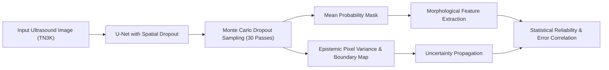
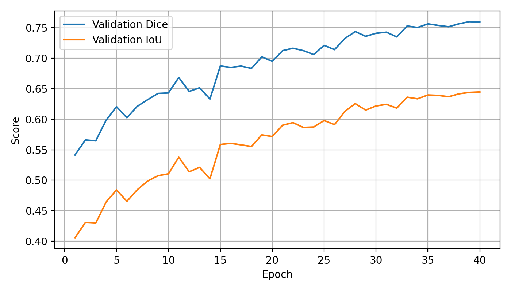
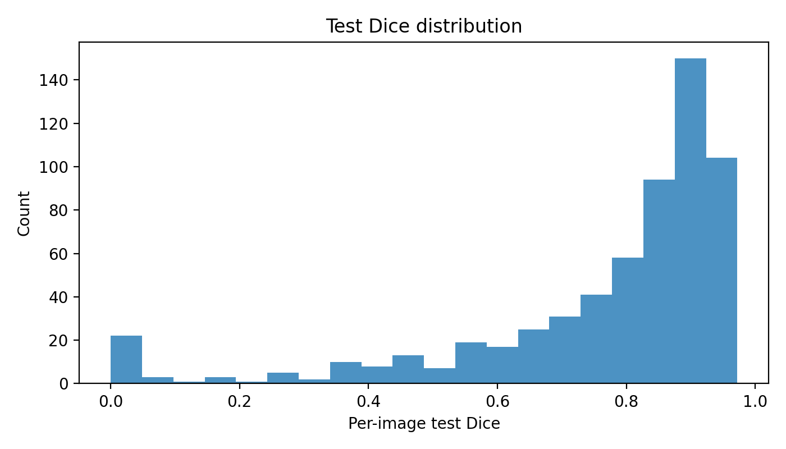
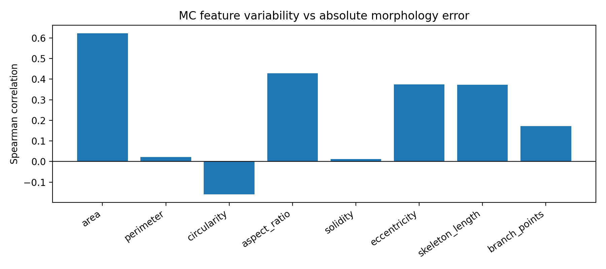
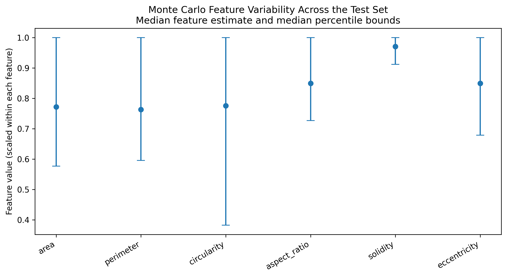

# ThyroVision: An Uncertainty-Aware and Explainable Framework for Thyroid Nodule Segmentation and Morphological Analysis in Ultrasound Images

[](https://www.python.org/)
[](https://pytorch.org/)
[](https://opensource.org/licenses/MIT)
[](https://jupyter.org/)
[](https://github.com/Sysu-gy/TN3K)

---

## 📌 Overview

Segmenting nodule regions from thyroid ultrasound images poses significant challenges due to low contrast, speckle noise, ambiguous acoustic shadows, and high morphological variability. While deep learning segmentation architectures (such as U-Net) provide nodule delineations, standard deterministic models fail to represent predictive uncertainties in both segmentation masks and downstream morphological measurements.

**ThyroVision** is an end-to-end framework integrating deep learning segmentation with **Monte Carlo (MC) Dropout** for predictive uncertainty estimation. It propagates spatial uncertainty into extracted clinical morphological descriptors (area, perimeter, circularity, aspect ratio, solidity, eccentricity, skeleton length, and branch points) and assesses empirical reliability against ground truth errors.

---

## 👥 Authors & Affiliations

- **Parimisetty Sneha Deepika** (`AV.SC.U4AIE23034`)
- **Ammisetty Nayana** (`AV.SC.U4AIE23051`)

*Department of Computer Science and Engineering (Artificial Intelligence), Amrita Vishwa Vidyapeetham*

---

## 🔬 Key Contributions

1. **Integrated Uncertainty-Aware Segmentation Pipeline:** Combines a custom U-Net architecture with Monte Carlo Dropout sampling ($N = 30$ stochastic forward passes) to estimate pixel-wise and boundary predictive variance.
2. **Uncertainty Propagation into Morphology:** Quantifies variability across stochastic nodule masks to produce empirical confidence intervals for geometric and skeleton descriptors.
3. **Rigorous Statistical Validation:** Evaluates Spearman rank correlations between estimated uncertainties and real segmentation/morphological errors, backed by **Benjamini-Hochberg False Discovery Rate (FDR)** multiple testing corrections.
4. **Boundary Error Tracking:** Demonstrates strong correlation ($\rho = 0.6995, p < 10^{-89}$) between boundary uncertainty and segmentation errors, pinpointing low-confidence delineations for clinical review.

---

## 🏗️ Architecture & Workflow



---

## 📊 Experimental Results & Validation

Evaluated on the **TN3K** thyroid ultrasound benchmark test set ($N = 614$ images):

### 1. Segmentation Performance (Test Set, N = 614)

| Metric | Mean | Standard Deviation |
|---|:---:|:---:|
| **Dice Similarity Coefficient (DSC)** | **76.52%** | $\pm$ 22.31% |
| **Intersection over Union (IoU)** | **66.10%** | $\pm$ 23.35% |
| **Precision** | **79.33%** | $\pm$ 22.14% |
| **Recall (Sensitivity)** | **81.10%** | $\pm$ 21.87% |
| **Best Validation Dice** | **75.98%** | (Epoch 39/40) |

---

### 2. Uncertainty vs. Segmentation Error Correlation

| Uncertainty Measure | Error Metric | Spearman's $\rho$ | $p$-value | Significance |
|---|---|:---:|:---:|:---:|
| **Boundary Uncertainty** | Dice Error ($1 - \text{Dice}$) | **0.6995** | $4.83 \times 10^{-90}$ | Statistically Significant |
| **Boundary Uncertainty** | IoU Error ($1 - \text{IoU}$) | **0.6995** | $4.83 \times 10^{-90}$ | Statistically Significant |
| **Mean Pixel Variance** | Dice Error | **0.3750** | $6.14 \times 10^{-22}$ | Statistically Significant |
| **Mean Entropy** | Dice Error | 0.0533 | 0.1873 | Not Significant |

---

### 3. Morphology Error vs. Uncertainty Correlations (Benjamini-Hochberg FDR Corrected)

| Morphological Feature | Sample Size ($N$) | Spearman's $\rho$ | Raw $p$-value | BH-FDR Adjusted $p$-value | Significant ($\alpha = 0.05$) |
|---|:---:|:---:|:---:|:---:|:---:|
| **Area** | 605 | **0.6233** | $2.03 \times 10^{-66}$ | $1.62 \times 10^{-65}$ | **Yes** |
| **Aspect Ratio** | 605 | **0.4280** | $2.42 \times 10^{-28}$ | $9.70 \times 10^{-28}$ | **Yes** |
| **Eccentricity** | 605 | **0.3751** | $1.19 \times 10^{-21}$ | $3.18 \times 10^{-21}$ | **Yes** |
| **Skeleton Length** | 605 | **0.3731** | $2.04 \times 10^{-21}$ | $4.08 \times 10^{-21}$ | **Yes** |
| **Branch Points** | 605 | **0.1714** | $2.24 \times 10^{-5}$ | $3.58 \times 10^{-5}$ | **Yes** |
| **Circularity** | 605 | -0.1589 | $8.70 \times 10^{-5}$ | $1.16 \times 10^{-4}$ | **Yes** |
| **Perimeter** | 605 | 0.0211 | 0.6044 | 0.6907 | No |
| **Solidity** | 605 | 0.0116 | 0.7760 | 0.7760 | No |

---

## 📈 Visualizations

The training dynamics, distribution plots, and correlation curves generated during the research are stored in `ThyroVision_Research_Results/`:

| Training History | Test Dice Distribution |
| :---: | :---: |
|  |  |

| Uncertainty vs. Error Correlation | Feature Uncertainty Intervals |
| :---: | :---: |
|  |  |

---

## 📁 Repository Structure

```text
├── README.md                                                   # Detailed project documentation
├── .gitignore                                                  # Git exclusion rules
├── ThyroVision_Uncertainty_Aware_Complete_Source_Code.ipynb     # Complete training and evaluation Colab notebook
├── ThyroVision_Research_Results/                               # Experimental checkpoints and artifacts
│   ├── best_unet_mc.pth                                        # Trained model weights (Epoch 39)
│   ├── experiment_summary.json                                 # High-level training and test run metadata
│   ├── split_manifest.json                                     # Reproducible train/val/test data splits
│   ├── train_feature_scaling.json                              # Normalization factors for morphology descriptors
│   ├── training_history.csv                                    # Per-epoch loss, Dice, and IoU curves
│   ├── test_image_metrics.csv                                  # Image-level evaluation metrics (N=614)
│   ├── uncertainty_morphology_test.csv                         # Propagated MC morphology metrics
│   ├── uncertainty_error_correlations.csv                      # Statistical correlation summary
│   ├── exploratory_irregularity_reliability.csv                # Irregularity index evaluation table
│   └── *.png                                                   # Research result visual plots
└── ThyroVision_Paper_Validation_Checks/                        # Validation scripts and sanity checks
    ├── paper_validation_summary.json                           # Overall validation verification summary
    ├── interval_coverage_width.csv                             # Empirical coverage analysis of MC intervals
    ├── morphology_correlations_BH_corrected.csv                # Multiple testing corrected p-values
    └── uncertainty_segmentation_error_correlations.csv         # Boundary and pixel variance analysis
```

---

## 🚀 Getting Started

### 1. Prerequisites

Ensure you have Python 3.9+ installed and a CUDA-capable GPU (recommended for Monte Carlo forward passes).

```bash
git clone https://github.com/SnehaDeepikaP/ThyroVision.git
cd ThyroVision
```

### 2. Environment Setup

Install the required Python dependencies:

```bash
pip install torch torchvision torchaudio --index-url https://download.pytorch.org/whl/cu118
pip install numpy pandas scipy scikit-learn scikit-image opencv-python matplotlib tqdm tabulate
```

### 3. Running the Research Notebook

Open the provided notebook in Google Colab or your local Jupyter environment:

```bash
jupyter notebook ThyroVision_Uncertainty_Aware_Complete_Source_Code.ipynb
```

- Configure your Kaggle API key (`kaggle.json`) or specify your local `DATA_ROOT` pointing to the **TN3K** dataset.
- The notebook executes end-to-end data preparation, training, MC Dropout inference ($N = 30$), morphological feature extraction, and automated results export.

---

## ⚠️ Safeguards & Clinical Disclaimer

- **Exploratory Research:** The morphological descriptors and reliability indices computed in this repository are exploratory engineering metrics designed to quantify segmentation uncertainty. They **do not** constitute clinical risk scores or diagnostic predictions for thyroid malignancy.
- **Data Splitting Caution:** While a reproducible split manifest is included, medical imaging datasets with multiple frames per patient require official patient-level splits to guarantee zero patient leakage prior to translation into clinical trials.

---

## 📜 Citation

If you use ThyroVision or find our research code helpful, please cite:

```bibtex
@misc{thyrovision2026,
  title={ThyroVision: An Uncertainty-Aware and Explainable Framework for Thyroid Nodule Segmentation and Morphological Analysis in Ultrasound Images},
  author={Sneha Deepika, Parimisetty and Nayana, Ammisetty},
  year={2026},
  institution={Amrita Vishwa Vidyapeetham}
}
```
